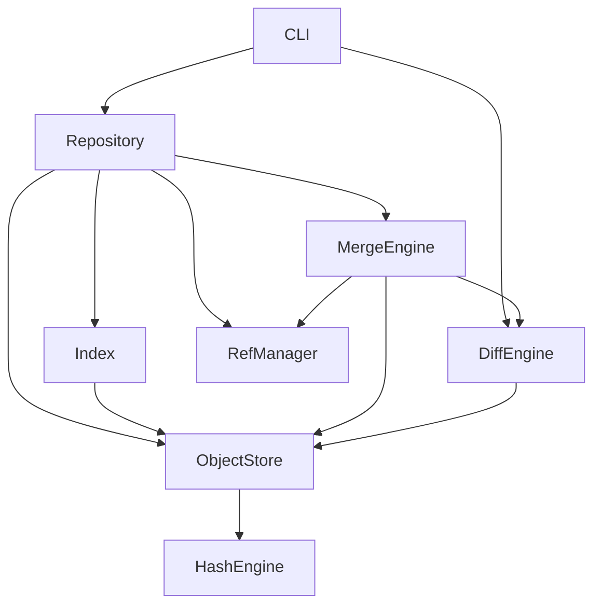

# MiniGit — Architecture Document

## 1. Problem Definition

Version control systems solve the problem of **tracking changes to a set of files over time**. At their core, they must:

1. Take **snapshots** of a directory at a point in time.
2. Store snapshots **efficiently** (avoid storing redundant copies).
3. Allow **retrieval** of any previous snapshot.
4. Support **parallel lines of development** (branches).
5. Allow **merging** of divergent work.
6. Detect and surface **conflicts** when merging.

MiniGit is a simplified, local-only version control system that demonstrates these fundamentals.

---

## 2. Minimum Viable Product (MVP)

The MVP supports these operations:

| Command | Purpose |
|---------|---------|
| `minigit init` | Create a new repository |
| `minigit add <file>` | Stage a file for commit |
| `minigit add .` | Stage all modified files |
| `minigit status` | Show working tree vs index vs HEAD |
| `minigit commit -m "msg"` | Create an immutable snapshot |
| `minigit log` | Walk the commit history |
| `minigit show <commit>` | Display commit details |
| `minigit diff` | Compare working tree to index or commits |
| `minigit checkout <commit>` | Restore a previous snapshot |
| `minigit branch` | List branches |
| `minigit branch <name>` | Create a new branch |
| `minigit checkout <branch>` | Switch to a branch |
| `minigit merge <branch>` | Three-way merge with conflict detection |

---

## 3. Non-Goals

The following are **explicitly out of scope**:

- Remote repositories (no `push`, `pull`, `fetch`, `clone`)
- Networking / HTTP / SSH
- Pack files or delta compression
- Rebasing
- Stashing
- Tagging (could be a stretch goal)
- Submodules
- Hooks
- GUI
- Authentication / permissions
- Symbolic links
- Binary file diffing
- Partial / sparse checkout
- `.gitignore` (may be added as a stretch goal)

---

## 4. Repository Layout

When `minigit init` is run, it creates this structure:

```
.minigit/
├── objects/         # Content-addressable object store
│   ├── ab/          # First 2 hex chars of hash (fan-out)
│   │   └── cdef...  # Remaining hex chars
│   └── ...
├── refs/
│   └── heads/       # Branch pointers (each is a file containing a commit hash)
│       └── main     # Default branch
├── HEAD             # Points to current branch: "ref: refs/heads/main"
├── index            # Staging area (binary or structured file)
└── config           # Repository configuration (author name, etc.)
```

### Why fan-out directories for objects?

Storing all objects as flat files in a single directory is slow on many filesystems when the count grows large. Using the first 2 hex characters as a subdirectory (256 possible buckets) keeps directory sizes manageable. This is the same approach Git uses.

---

## 5. Data Model

### 5.1 Object Types

Every object is identified by the **SHA-256 hash** of its serialized content. Three types exist:

#### Blob

Stores raw file contents. Nothing else — no filename, no metadata.

```
Serialized format:
  "blob <size>\0<raw bytes>"

Example:
  "blob 12\0Hello world\n"

Hash:
  SHA-256 of the above → object ID
```

#### Tree

Stores a directory snapshot: a sorted list of entries.

```
Serialized format:
  "tree <size>\0<entries>"

Each entry:
  "<mode> <type> <hash> <name>\n"

Example:
  "tree 95\0"
  "100644 blob a948904f... README.md\n"
  "100644 blob 7d865e95... main.cpp\n"
  "040000 tree 3b18e512... src\n"
```

- `100644` = regular file
- `040000` = subdirectory (tree)
- Entries are **sorted by name** for deterministic hashing.

#### Commit

Links a tree to its history and metadata.

```
Serialized format:
  "commit <size>\0"
  "tree <tree-hash>\n"
  "parent <parent-hash>\n"       ← omitted for initial commit
  "author <name> <timestamp>\n"
  "message <commit message>\n"
```

### 5.2 Why SHA-256?

- SHA-1 (used by Git historically) has known collision attacks.
- SHA-256 is available in many platforms and is the modern standard.
- We will implement or use a portable SHA-256 (a small standalone implementation bundled with the project, no external crypto library required).

### 5.3 Object Identity Rules

| Property | Guarantee |
|----------|-----------|
| Same content → same hash | Always (deterministic) |
| Different content → different hash | Practically always (collision-resistant) |
| Object immutable after creation | Always (content defines identity) |
| Hash verifies integrity | Always (recompute and compare) |

---

## 6. Object Relationships

```
                   HEAD
                    │
                    ▼
              refs/heads/main
                    │
                    ▼
               ┌─────────┐
               │  Commit  │──── tree hash ────┐
               │  C3      │                   │
               │  parent ─┼── C2              ▼
               └─────────┘              ┌──────────┐
                                        │   Tree   │
                                        │ (root)   │
                                        └────┬─────┘
                                             │
                           ┌─────────────────┼─────────────────┐
                           ▼                 ▼                 ▼
                     ┌──────────┐     ┌──────────┐     ┌──────────┐
                     │   Blob   │     │   Blob   │     │   Tree   │
                     │ README   │     │ main.cpp │     │   src/   │
                     └──────────┘     └──────────┘     └────┬─────┘
                                                            │
                                                            ▼
                                                      ┌──────────┐
                                                      │   Blob   │
                                                      │ util.cpp │
                                                      └──────────┘
```

### Traversal paths:

1. **HEAD → branch → commit**: Find current snapshot.
2. **Commit → tree → blobs/subtrees**: Reconstruct working directory.
3. **Commit → parent → parent → ...**: Walk history (log).
4. **Two commits → merge base**: Find common ancestor for merging.

---

## 7. Data Flow

### `minigit add <file>`

```
Working file
    │
    ├──→ Read file contents
    ├──→ Hash contents → blob ID
    ├──→ Store blob in .minigit/objects/<prefix>/<suffix>
    └──→ Update index: record (path, blob ID, timestamp)
```

### `minigit commit -m "message"`

```
Index entries
    │
    ├──→ Group entries by directory
    ├──→ Build tree objects (bottom-up, leaves first)
    │       Each directory → Tree object → stored in objects/
    │       Root directory → root tree hash
    ├──→ Create commit object
    │       tree = root tree hash
    │       parent = current HEAD commit (if any)
    │       author, timestamp, message
    ├──→ Store commit in objects/
    ├──→ Update current branch ref to point to new commit
    └──→ (HEAD still points to branch name — unchanged)
```

### `minigit checkout <commit>`

```
Target commit hash
    │
    ├──→ Read commit object → get tree hash
    ├──→ Recursively read tree → collect (path, blob hash) for all files
    ├──→ Compare with current working tree
    │       If modified files exist → abort (safety check)
    ├──→ Remove files not in target tree
    ├──→ Write/overwrite files from target tree's blobs
    └──→ Update HEAD (detached HEAD if checking out a raw commit)
```

### `minigit merge <branch>`

```
Current branch commit (OURS)  +  Target branch commit (THEIRS)
    │
    ├──→ Find merge base (common ancestor) → BASE commit
    ├──→ Extract trees: BASE tree, OURS tree, THEIRS tree
    ├──→ For each file path across all three trees:
    │       ├── Unchanged in both → keep as-is
    │       ├── Changed only in OURS → keep OURS
    │       ├── Changed only in THEIRS → take THEIRS
    │       ├── Changed identically → keep either (same result)
    │       └── Changed differently → CONFLICT → write markers
    ├──→ If no conflicts:
    │       Create merge commit with two parents
    │       Update branch ref
    └──→ If conflicts:
            Write conflicted files to working tree
            Report conflicts to user
            Do NOT create a commit
```

---

## 8. Component Architecture

```
┌─────────────────────────────────────────────────────────┐
│                        CLI Layer                         │
│  Parses commands, validates arguments, calls services    │
└──────────────┬──────────────────────────────┬────────────┘
               │                              │
     ┌─────────▼──────────┐        ┌──────────▼──────────┐
     │   Repository       │        │   Diff Engine       │
     │   - init           │        │   - line diff       │
     │   - find repo root │        │   - file diff       │
     │   - config         │        │   - tree diff       │
     └─────────┬──────────┘        └─────────────────────┘
               │
     ┌─────────┼──────────────────────────────┐
     │         │                              │
┌────▼────┐ ┌──▼───────────┐ ┌───────────────▼──┐
│ Object  │ │   Index      │ │   Refs / Branch  │
│ Store   │ │   (staging)  │ │   Manager        │
│ - blob  │ │   - add      │ │   - HEAD         │
│ - tree  │ │   - remove   │ │   - branches     │
│ - commit│ │   - status   │ │   - create/delete│
└────┬────┘ └──────────────┘ └──────────────────┘
     │
┌────▼──────────────┐    ┌───────────────────┐
│   Hash Engine     │    │   Merge Engine    │
│   - SHA-256       │    │   - merge base    │
│   - compute       │    │   - three-way     │
│   - verify        │    │   - conflicts     │
└───────────────────┘    └───────────────────┘
```

### Component Responsibilities

| Component | Responsibility | Key Classes |
|-----------|---------------|-------------|
| **CLI** | Parse command-line args, dispatch to correct handler, format output | `CLI`, `CommandParser` |
| **Repository** | Locate/initialize `.minigit`, coordinate components | `Repository` |
| **ObjectStore** | Read/write/hash content-addressable objects | `ObjectStore`, `Blob`, `Tree`, `Commit` |
| **Index** | Manage the staging area between working tree and commits | `Index`, `IndexEntry` |
| **Refs** | Manage branch pointers and HEAD | `RefManager` |
| **Diff** | Compare blobs, trees, and working tree | `DiffEngine`, `DiffResult` |
| **Merge** | Find merge base, three-way merge, conflict detection | `MergeEngine` |
| **Hash** | SHA-256 computation | `SHA256` |
| **Utils** | Filesystem helpers, error types, serialization | Various |

---

## 9. Dependency Graph Between Components



**Key rule**: Dependencies flow downward. The CLI depends on everything, but core components (HashEngine, ObjectStore) depend on nothing above them.

---

## 10. Testing Strategy

### Levels of Testing

| Level | What it tests | Framework |
|-------|--------------|-----------|
| **Unit tests** | Individual classes/functions in isolation | CTest + lightweight assertions |
| **Integration tests** | Multiple components working together | CTest + temp directories |
| **CLI tests** | End-to-end command execution | CTest + subprocess invocation |

### Test Infrastructure

- Every test creates a **temporary directory** as its working directory.
- Tests are **isolated** — no shared state between tests.
- Tests clean up after themselves.
- We use **CTest** (built into CMake) as the test runner.
- We write a small `test_utils.h` with assertion macros and temp-dir fixtures.

### What Gets Tested

| Component | Test Focus |
|-----------|-----------|
| HashEngine | Determinism, known test vectors |
| ObjectStore | Write/read roundtrip, corruption detection, deduplication |
| Index | Add/remove/modify entries, serialization roundtrip |
| Tree builder | Deterministic output, nested directories |
| Commit | Parent chain, metadata, persistence |
| Diff | Added/removed/modified lines, edge cases |
| Refs | Branch create/delete/list, HEAD updates |
| Merge | Clean merge, conflicts, merge base finding |
| CLI | Command parsing, error messages, end-to-end flows |

### Why Not GoogleTest?

GoogleTest is excellent, but:
1. It adds a build dependency that must be fetched.
2. For this project, a lightweight approach teaches you more about testing.
3. We can always migrate to GoogleTest later if needed.

We will use a small set of macros:
```cpp
#define ASSERT_TRUE(cond) ...
#define ASSERT_EQ(a, b) ...
#define ASSERT_THROWS(expr) ...
```

---

## 11. Phase Roadmap

| Phase | Title | Key Deliverable |
|-------|-------|----------------|
| 0 | Project Design | Architecture docs (this document) |
| 1 | CLI + Repository Init | `minigit init`, CLI parser, `.minigit/` creation |
| 2 | Content-Addressable Storage | Blob objects, SHA-256, ObjectStore |
| 3 | Index / Staging Area | `minigit add`, `minigit status`, Index |
| 4 | Tree Objects | Directory snapshots, TreeBuilder |
| 5 | Commits | `minigit commit`, commit objects, parent chain |
| 6 | Log + Show | `minigit log`, `minigit show`, history traversal |
| 7 | Diff Engine | `minigit diff`, line-based LCS diff |
| 8 | Checkout | `minigit checkout <commit>`, tree restoration |
| 9 | Branches + HEAD | Branch management, ref updates |
| 10 | Merge Base | DAG traversal, lowest common ancestor |
| 11 | Three-Way Merge | `minigit merge`, conflict markers |
| 12 | Recovery + Robustness | Atomic writes, corruption handling, error types |
| 13 | Testing + Quality | Full test pass, sanitizers, cleanup |
| 14 | Benchmarking | Performance measurement |
| 15 | Documentation | README, architecture diagrams |
| 16 | Interview Preparation | Q&A document with source references |

### Phase Dependencies

```
Phase 0 (Design)
    └──→ Phase 1 (CLI + Init)
            └──→ Phase 2 (Object Store)
                    └──→ Phase 3 (Index)
                            └──→ Phase 4 (Trees)
                                    └──→ Phase 5 (Commits)
                                            ├──→ Phase 6 (Log + Show)
                                            ├──→ Phase 7 (Diff)
                                            └──→ Phase 8 (Checkout)
                                                    └──→ Phase 9 (Branches)
                                                            └──→ Phase 10 (Merge Base)
                                                                    └──→ Phase 11 (Merge)
                                                                            └──→ Phase 12 (Robustness)
                                                                                    └──→ Phase 13 (Testing)
                                                                                            └──→ Phase 14 (Benchmarks)
                                                                                                    └──→ Phase 15 (Docs)
                                                                                                            └──→ Phase 16 (Interview)
```
